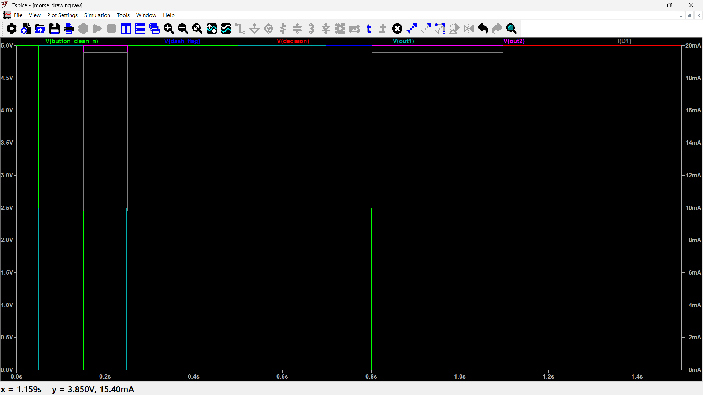

# 🔦 Morse Code Flashlight Transmitter ⚡
### A Standalone, No-Microcontroller Morse Keyer

## 📖 Project Overview
This project is a standalone Morse-code flashlight transmitter built entirely from *discrete logic ICs and 555 timers*. It does not use an Arduino, ESP32, or any development board. 

A single momentary pushbutton is used to input Morse code. The circuit measures the press duration, classifies it as a *DOT* (short press) or a *DASH* (long press), and triggers a flashlight LED for the corresponding duration.

*   *DOT:* Press < 200 ms ➔ LED flashes for ~100 ms
*   *DASH:* Press ≥ 200 ms ➔ LED flashes for ~300 ms

---

## 🧠 How It Works (The Logic Flow)
Instead of using a fragile 10 Hz clock/counter to measure time (which suffers from phase-alignment issues), this design uses a *200 ms One-Shot Threshold Detector*. 

1.  *Press:* The button is pressed. The 74HC14 cleans the bounce. The NODE_P differentiator clears the flip-flops, and the NE555 #1 (200 ms timer) starts.
2.  *Measure:* If the button is released before 200 ms, the DASH_FLAG remains LOW (0). If held past 200 ms, the timer expires, and the DASH_FLAG latches HIGH (1).
3.  *Release:* Upon release, a 74HC74 D-Flip-Flop samples the DASH_FLAG and locks in the decision (DECISION = 0 for DOT, 1 for DASH).
4.  *Flash:* The 74HC4066 analog switch reads the DECISION and routes either a 91kΩ resistor (DOT) or a 270kΩ resistor (DASH) to the NE555 #2 monostable.
5.  *Output:* NE555 #2 fires a pulse of 100 ms or 300 ms, driving an NPN transistor to light the LED.

---

## 🛠️ Bill of Materials (BOM)

| Reference | Component | Value / Type | Qty | Notes |
| :--- | :--- | :--- | :--- | :--- |
| *U1* | 74HC14 | Hex Schmitt-Trigger Inverter | 1 | Switch debounce & edge detection |
| *U2* | NE555 | Timer | 1 | 200 ms Threshold One-Shot |
| *U3* | 74HC74 | Dual D Flip-Flop | 1 | Memory/Latch for DOT/DASH decision |
| *U4* | NE555 | Timer | 1 | 100 ms / 300 ms Flash Timer |
| *U5* | 74HC4066 | Quad Analog Switch | 1 | Selects the timing resistor |
| *Q1* | 2N2222 | NPN Transistor | 1 | LED Driver |
| *SW1* | Pushbutton | Momentary (Normally Open) | 1 | Input Key |
| *D1-D7* | 1N4148 | Signal Diode | 7 | Edge detection & clamping |
| *LED1*| LED | 20 mA indicator or Power LED | 1 | The flashlight output |
| *R1* | Resistor | 10 kΩ | 1 | Button pull-up |
| *R2, R4, R5, R6* | Resistor | 100 kΩ | 4 | Pull-ups/downs for differentiators |
| *R3* | Resistor | 182 kΩ (or 180k) | 1 | 200 ms threshold (1% preferred) |
| *R7* | Resistor | 91 kΩ (or 82k) | 1 | DOT flash timing (1% preferred) |
| *R8* | Resistor | 270 kΩ | 1 | DASH flash timing (1% preferred) |
| *R9* | Resistor | 4.7 kΩ | 1 | Q1 Base resistor |
| *R10* | Resistor | 150 Ω | 1 | LED current limiting |
| *C1, C7* | Capacitor | 100 nF ceramic | 2 | Debounce & Power-On Reset |
| *C2, C4, C5, C6, C9* | Capacitor | 10 nF ceramic | 5 | Differentiators & 555 CTRL bypass |
| *C3, C8* | Capacitor | 1 µF Film | 2 | Timing capacitors (avoid electrolytics) |
| *C_byp* | Capacitor | 100 nF ceramic | 5 | One per IC, local power bypass |
| *C_bulk* | Capacitor | 10 µF | 1 | Near power entry |

---

## 🧮 Timing Calculations
The core timing uses the standard 555 monostable formula: *t = 1.1 * R * C*

| Function | Resistor | Capacitor | Formula | Nominal Result |
| :--- | :--- | :--- | :--- | :--- |
| *200ms Threshold* | 182 kΩ | 1 µF | 1.1 * 182,000 * 0.000001 | *200.2 ms* |
| *DOT Flash* | 91 kΩ | 1 µF | 1.1 * 91,000 * 0.000001 | *100.1 ms* |
| *DASH Flash* | 270 kΩ | 1 µF | 1.1 * 270,000 * 0.000001 | *297.0 ms* |

Note: Using 1% resistors and Film capacitors (for C3, C8) ensures these timings stay within ±2-3 ms of the target. Generic electrolytic capacitors can drift by ±20%, which will ruin the DOT/DASH boundary.

---

## 🔌 Critical Wiring Notes (Breadboard Build)

When building this on a breadboard, pay special attention to these common pitfalls:

1.  *Cascading Inverters (74HC14):* You must short *Pin 2 to Pin 3, **Pin 10 to Pin 13, and **Pin 12 to Pin 5* directly on the chip. These are internal logic chains.
2.  *Active-LOW Pins (74HC74):* Pins 4 and 10 (/PRE - Preset) must be tied directly to +5V. If they float, the chip will lock up and refuse to clock.
3.  *Differentiator Nodes:*
    *   NODE_P: Pull-up to +5V (R4), clamped to +5V (D5). Feeds U3 Clear pins (1 & 13).
    *   NODE_R: Pull-DOWN to GND (R5), clamped to GND (D6). Feeds U1 Pin 11.
4.  *Analog Switch (74HC4066):* Unused switches (Pins 6, 8, 9, 10, 11, 12) must be tied to *GND* to prevent floating CMOS inputs from oscillating.
5.  *Power:* Place a 100 nF capacitor between VCC and GND right next to every single IC. 555 timers draw sharp current spikes.

---

## 🚦 Step-by-Step Testing Guide

Do not power up the whole board at once. Build and test in stages:

*   *Stage 1: Power & Input.* Verify 5V. Check BUTTON_RAW goes 5V ➔ 0V when pressed.
*   *Stage 2: U1 & U2.* Press the button. Check U2 Pin 3 (OUT1) goes HIGH for exactly 200 ms, then goes back LOW (even if you hold the button).
*   *Stage 3: U3 Latch.* Probe U3 Pin 9 (DECISION). 
    *   Quick tap ➔ Pin 9 = 0V. 
    *   Long hold (>0.5s) ➔ Pin 9 = 5V.
*   *Stage 4: U4, U5 & LED.* 
    *   Force a DOT (tap) ➔ LED should flash for 100 ms.
    *   Force a DASH (hold) ➔ LED should flash for 300 ms.

---

## ⚠️ Known Limitations & Fixes

*   *Resistor Substitutions:* If you cannot find 182kΩ or 91kΩ, use standard E12 values. 
    *   182kΩ ➔ 180kΩ (Gives 198 ms threshold).
    *   91kΩ ➔ 82kΩ (Gives 90 ms DOT) OR 180kΩ || 180kΩ (Gives 90kΩ ➔ 99 ms DOT).
*   *Do not press during flash:* The NE555 #2 monostable is not retriggerable. Wait for the LED to turn off before pressing the key again (this is natural for Morse code operation).
*   *High-Power LEDs:* If using a high-power LED (e.g., 1W), you must recalculate R10 and R9. A 2N2222 can handle ~500mA, but you need to provide sufficient base current (approx 50mA). A logic-level MOSFET (like 2N7000) is recommended for high-power builds. 

---
---

## 📈 LTspice Simulation & Verification

Before assembling the physical breadboard, the complete logic architecture was simulated in **LTspice** using behavioral models. This verified the asynchronous edge detection, monostable timing, and latch memory without the risk of damaging physical components.

*(Note to repo owner: Upload your LTspice screenshot to the repo and name it `simulation.png`, or change the link above to match your image filename).*

### Trace Breakdown (What the simulation proves):
*   🟢 **Green (`V(button_clean_n)`)**: The debounced input signal from the button.
*   🩵 **Teal (`V(out1)`)**: The 200 ms threshold timer (NE555 #1).
*   🔴 **Red (`V(decision)`)**: The output of the decision latch (74HC74).
*   🟣 **Purple (`V(out2)`)**: The final flash output (NE555 #2).
*   🔵 **Blue (`V(flash_trig)`)**: The trigger pulse generated on button release.

### Simulation Results:
1.  **First Press (Left side of plot):** The button is released *before* the 200 ms timer (`out1`) finishes. The latch (`decision`) stays LOW (0V). On release, the flash timer (`out2`) pulses for exactly **100 ms**. (Correct DOT behavior).
2.  **Second Press (Right side of plot):** The button is held until the 200 ms timer (`out1`) finishes its cycle. The latch (`decision`) successfully flips HIGH (5V). On release, the flash timer (`out2`) pulses for exactly **300 ms**. (Correct DASH behavior).

This simulation confirms that the **200 ms classification boundary is completely phase-independent** and the logic is ready for physical implementation.

---
Created as a discrete-logic alternative to microcontroller-based Morse keyers. Happy Hacking!
